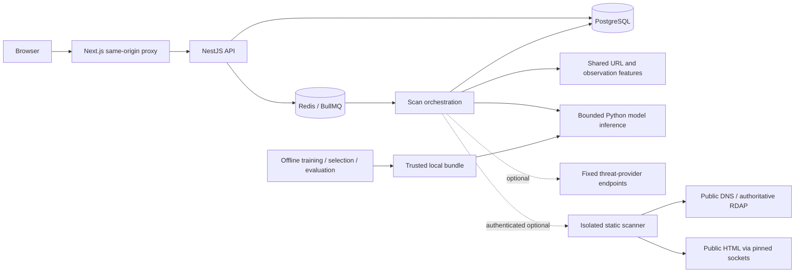

# Architecture

The NestJS queue worker shares the API process; target fetching runs in a separate Python container. Default-off content/domain flags require a validated internal worker endpoint and token. The worker installs namespace firewall rules before dropping privileges. No target script, wallet action or form is executed. Optional provider lookup sends the submitted URL to fixed endpoints.

## Boundaries

- `packages/core`: URL policy, versioned numeric features, warning rules and shared observation extraction. No network or persistence access.
- `apps/api`: validation, TypeORM persistence, BullMQ jobs/recovery, adapter orchestration and serialized reports. Content/domain/provider observations remain attributable and bounded.
- `services/analysis-worker`: public DNS filtering, pinned connections/peer checks, redirect validation, bounded static HTML and RDAP parsing. Independent kernel egress filtering is required; actual container verification is pending locally.
- `apps/web`: same-origin proxy, responsive reports/history/research/settings. Evidence renders as text; backend secrets stay server-side.
- `ml`: published benchmark preparation, connected groups, temporal/group splits, calibration, validation selection, frozen holdout evaluation and controlled promotion. Production invokes only a selected trusted-local bundle with matching schema/checksum.

## Lifecycle and failures

Persist queued scans before enqueueing. Three worker attempts use bounded exponential backoff. Major unavailable evidence produces partial reports; failed submissions remain saved. Completed/partial jobs are idempotent. Startup reconciles queued/running scans with UUID keyset pagination in batches of 200; terminal queue jobs update nonterminal records. There is no old 1,000-row recovery cap.

Reports preserve historical evidence. Serialization refreshes each provider's authority independently at read time without modifying stored observations. If all positive reports expire, the assessment falls back to independent screening/model evidence. Model probability and provider authority are separate.

Migrations use transaction advisory locks; PostgreSQL timestamps match JavaScript millisecond precision. Tests use a separate `_test` database and Redis DB 1. Queue producers have bounded commands/retries; worker Redis connections remain persistent.

## Operational limits

Local shared history has no authentication, automatic retention or tenant boundaries. Rate limiting is per process. The Python subprocess starts per scan, so model startup dominates batch inference timing. Current artifacts are lexical phishing-only. Hybrid schema support is not evidence of hybrid accuracy; it requires reviewed historical snapshots and appropriate labels.
