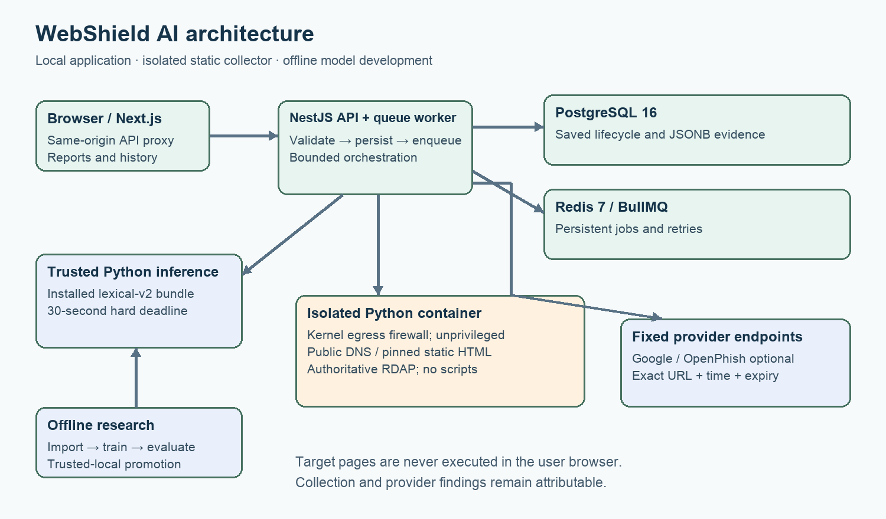
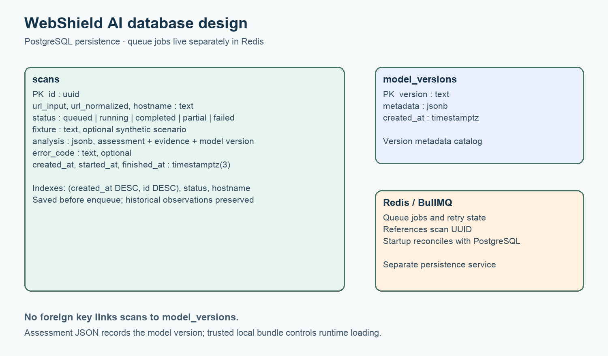

# WebShield AI Final Year Project Report

**AI Powered Website Risk Analysis and Explainable Phishing Screening**

**SAMPLE / DEMONSTRATION COVER DETAILS.** Sample Student · FYP-0000 · Sample BS Computer Science · Sample Department of Computer Science · Sample University · Sample Supervisor · Sample Session 2025–2026. Prepared 12 October 2026. These identities are dummy information requested for presentation. They do not identify an actual student, supervisor or institution. No declaration, approval or academic acceptance is implied.

## Abstract

WebShield AI is a controlled research prototype that accepts public website URLs and presents an explained assessment using URL structure, optional isolated static HTML and domain observations, current threat-provider reports and a calibrated phishing model. A Next.js interface communicates with a NestJS API; PostgreSQL stores scans and Redis/BullMQ manages asynchronous jobs. Target collection runs in a separate restricted Python container. Reports preserve the source, time, availability and expiry of evidence rather than treating missing observations as clean findings.

A custom chronological PhreshPhish experiment retains 148,352 canonical examples and purges overlapping registrable-domain components from earlier partitions. Three lexical baselines are trained and selected on validation data before the 36,910-record holdout is scored. The selected sigmoid-calibrated Histogram Gradient Boosting model achieves 96.84% phishing precision, 58.41% recall, 72.87% F1 and a 1.64% false-positive rate. This operating point trades recall for fewer false positives. It replaces an earlier model whose dataset collection conventions caused severe false positives on normal URLs.

Separate archived ScamFerret experiments compare URL, recorded domain age and static content on identical group-disjoint store, investment and cryptocurrency holdouts. Domain-enhanced recall is 52.08% with 0/118 legitimate false positives; adding content raises recall to 90.63% but produces 10/118 false positives, including 8/37 legitimate cryptocurrency sites. These models remain research-only. Timestamp-aligned historical threat-provider observations are absent. A separately collected 200-URL prospective pilot supplies current aligned observations but shows no incremental group-holdout hybrid gain and does not establish the historical hypothesis. A frozen character-based research candidate raises fresh pilot recall but produces 12% false positives on official references, so it is not promoted. The application and documented local verification support a controlled demonstration; neither a low estimate nor a missing provider match proves website or business legitimacy.

## Contents

1. Introduction and objectives
2. Related research
3. Requirements and scope
4. Architecture and database design
5. Detection and implementation
6. Dataset preparation and experimental method
7. Results and error analysis
8. Software verification and security
9. User interface and deployment
10. Proposal traceability and project outcome
11. Limitations and future work
12. Conclusion
13. References
14. Reproduction and evidence index

## 1 Introduction and objectives

### 1.1 Problem statement

Users encounter suspicious links through messages, advertisements, online stores and investment promotions. Professional branding, HTTPS and cryptocurrency terminology do not establish who operates a site or whether promised services will be delivered. URL patterns, page indicators and threat reports provide different kinds of evidence, each with incomplete coverage. An understandable assessment must show both the observations and their limits.

The project therefore implements a website-risk analysis workflow that supports review before a user enters credentials or sends funds. It distinguishes a statistical phishing estimate from observed warnings and independent provider reports. The implementation does not certify businesses, guarantee withdrawals or establish criminal conduct.

### 1.2 Objectives and achieved outcomes

| Objective from the proposal         | Implemented outcome                                                                                                  | Evaluation boundary                                                        |
| ----------------------------------- | -------------------------------------------------------------------------------------------------------------------- | -------------------------------------------------------------------------- |
| O1 Safe persistent scan application | Validated URL submission, saved asynchronous lifecycle, recovery and bounded retries                                 | Local PostgreSQL/Redis and HTTP acceptance                                 |
| O2 Fraud-indicator detection        | URL screening, public DNS/RDAP, isolated static forms/redirects, threat reports and crypto claims/address candidates | Indicators support review; broader fraud accuracy is unproven              |
| O3 Evaluated ML classification      | Logistic Regression, Random Forest and Histogram Gradient Boosting; calibrated selected model installed              | Current runtime model is lexical phishing-only                             |
| O4 Understandable risk reports      | Evidence tables, model context, freshness, history, resubmission and JSON export; light/dark responsive UI           | No guarantee of safety or independently verified business fraud            |
| O5 Verifiable research prototype    | Temporal phishing evaluation, archived fraud ablations, test/security evidence and reproducible tooling              | Historical threat ablation and independent academic acceptance remain open |

### 1.3 Research questions

RQ1 asks how three lexical baselines perform on later dated phishing examples after removing overlapping domain components from earlier periods. RQ2 asks whether recorded domain age and archived static content improve discrimination for published store, investment and cryptocurrency labels on a common unseen-domain holdout. RQ3 asks whether independent, timestamp-aligned threat observations improve a full historical hybrid model. RQ1 and RQ2 have measured local results; the available historical data do not answer RQ3. A separate prospective phishing/reference pilot tests current aligned feature groups on a small convenience cohort; its negative/inconclusive incremental results do not replace historical validation.

## 2 Related research

### 2.1 PhreshPhish and realistic phishing evaluation

Dalton and colleagues introduce PhreshPhish to address dataset quality, leakage and unrealistic class base rates in phishing research. Its emphasis on difficult, diverse evaluation motivates this project's explicit provenance, domain controls and dated partitions. WebShield uses a metadata sample and its own chronological split; its results do not reproduce the paper's benchmark protocol or establish superiority to the authors' models. [PhreshPhish primary paper](https://arxiv.org/abs/2507.10854).

### 2.2 ScamFerret and broader scam evidence

Nakano, Koide and Chiba study an autonomous LLM agent that gathers and interprets information about scam websites. Their released artifact provides published labels and archived evidence for several scam categories. WebShield reuses selected English shopping, investment and cryptocurrency artifacts for offline feature comparisons, without running the ScamFerret agent or visiting the listed sites. Its small classical-model experiment is a different task configuration and must not be compared directly with the paper's headline accuracy. [ScamFerret primary paper](https://arxiv.org/abs/2502.10110), [released artifact](https://github.com/ScamFerret/artifact).

### 2.3 PhiUSIIL and collection shortcuts

Prasad and Chandra publish a phishing URL dataset and detection framework. UCI provides 235,795 examples and documents its original label convention: 1 denotes legitimate and 0 denotes phishing. WebShield's importer reverses those labels for its own convention and avoids the source's precomputed label-dependent features. Local diagnosis found every legitimate source URL prefixed with `www.` and unsuitable normal-path behavior in the resulting model. That experiment is retained as a failure analysis; the current model uses a different dataset and feature version. [Official UCI dataset and citation](https://archive.ics.uci.edu/dataset/967/phiusiil+phishing+url+dataset).

### 2.4 Methodological position

The contribution is an integrated, explainable and bounded research workflow with measured limits. Validation-only model selection, frozen evaluation and explicit missingness reduce common sources of optimistic reporting. Calibration converts raw model scores to estimates on the available distribution; it cannot guarantee calibration under future traffic or a different phishing prevalence. [scikit-learn calibration documentation](https://scikit-learn.org/stable/modules/calibration.html).

## 3 Requirements and scope

### 3.1 Functional requirements

The following mapping preserves the numbering in the supplied proposal. The maintained SRS groups some implementation details differently; this table is the proposal acceptance mapping.

| Proposal requirement                | Delivered behavior                                                                       | Evidence                                          |
| ----------------------------------- | ---------------------------------------------------------------------------------------- | ------------------------------------------------- |
| FR-01 URL submission and validation | Bounded public HTTP(S) inputs; credentials, internal hosts and unsafe syntax rejected    | Core/API tests, readable form errors              |
| FR-02 Asynchronous processing       | UUID scan record saved before enqueue, queue states, retries and startup recovery        | Persistence/queue integration tests               |
| FR-03 URL and domain analysis       | Versioned lexical features, public DNS and authoritative RDAP when enabled               | Scanner tests and live acceptance                 |
| FR-04 AI detection                  | Trusted-local selected calibrated phishing bundle; missing inference remains unavailable | Model card, frozen evaluation, installed workflow |
| FR-05 Threat intelligence           | Configured Google/OpenPhish lookup with independent source/time/expiry                   | Provider tests and live acceptance                |
| FR-06 Content analysis              | Isolated bounded static HTML, forms, destinations and redirects                          | Scanner/content tests and live HTML observation   |
| FR-07 Crypto indicators             | Claims plus validated address candidates; no wallet or chain actions                     | Synthetic fixture and extraction tests            |
| FR-08 Explained assessment          | Model, rules, provider authority and missing checks remain distinct                      | Aggregation tests and saved reports               |
| FR-09 History and export            | Cursor pagination, stored report, new resubmission UUID and JSON attachment              | Integration and installed HTTP workflow           |
| FR-10 Safety/configuration          | Backend secrets, bounded inputs/output, text rendering and capability status             | Isolation, quality and browser checks             |

### 3.2 Nonfunctional requirements

The system bounds request size, URL length, network responses, child execution and inference. Collection must not reach private networks. Failures must be represented as unavailable or partial evidence. Frontend content is responsive, keyboard accessible and supports user-controlled themes. Experiments must record provenance and keep test data outside model/threshold selection.

### 3.3 Deployment scope

The supported environment is a controlled local demonstration. History is shared and has no user accounts, tenant isolation, automatic retention or storage quota. Public multi-tenant hosting is outside the delivered scope. Static HTML is supported; JavaScript execution, browser-based dynamic analysis, CAPTCHA bypass, automated takedown, screenshot classification and full on-chain tracing are excluded. The system never connects a wallet or requests seed phrases.

## 4 Architecture and database design

### 4.1 Components and trust boundaries



The browser calls a same-origin Next.js proxy, which forwards requests to NestJS. NestJS validates and persists a scan before placing a BullMQ job in Redis. Queue orchestration currently shares the API process. Shared TypeScript code extracts versioned features and warning rules. A bounded Python subprocess loads the installed phishing model; optional fixed-endpoint adapters query providers. A separate Python container performs public DNS, pinned static HTML and authoritative RDAP collection. Completed evidence is written to PostgreSQL and returned as serialized JSON.

Offline import, training, calibration and evaluation produce a trusted local bundle. Production does not train models or load user-uploaded joblib files. Checksummed model assets are published before the manifest is atomically replaced. Hash checks detect inconsistent artifacts but cannot authenticate an attacker who replaces both the model and manifest.

### 4.2 Database design



| Table or field                            | Purpose and constraint                                                                |
| ----------------------------------------- | ------------------------------------------------------------------------------------- |
| `scans.id`                                | UUID primary key; identifies a persisted submission                                   |
| `url_input`, `url_normalized`, `hostname` | Original input plus canonical scan target and search/filter context                   |
| `status`                                  | Check-constrained queued/running/completed/partial/failed state                       |
| `fixture`                                 | Optional synthetic scenario designation                                               |
| `analysis`                                | JSONB snapshot containing assessment, observations, features and limitations          |
| `error_code`                              | Processing failure classification without pretending missing checks passed            |
| `created_at`, `started_at`, `finished_at` | Lifecycle timestamps; millisecond precision matches JavaScript cursor ordering        |
| `model_versions.version`, `metadata`      | Model version metadata catalog; runtime loading authority is the trusted local bundle |

Indexes cover descending `(created_at,id)` history, status recovery and hostname lookup. There is no foreign key between `scans` and `model_versions`; the serialized assessment records its version within JSONB. Redis stores queue jobs independently of PostgreSQL. Migrations take a transaction advisory lock, reducing concurrent-start migration races.

### 4.3 Lifecycle and recovery

An accepted submission progresses from queued to running, then completed, partial or failed. A partial result can include useful evidence with one or more unavailable checks. Three worker attempts use bounded exponential backoff. Completed/partial processing is idempotent. Startup reconciliation scans queued/running rows using UUID keyset batches of 200, avoiding the former fixed 1,000-row recovery cap. Terminal queue failures update saved nonterminal records so the UI does not leave them indefinitely running.

## 5 Detection and implementation

### 5.1 URL and static collection policy

The API accepts at most 8 KB per request and URLs up to 4,096 characters. Core URL policy rejects credentials, nonpublic or ambiguous IP forms, internal names and disallowed ports. A public-looking hostname can still resolve internally, so the collector validates every DNS address, pins connections, checks the peer and validates each redirect. These layers complement kernel egress restrictions.

The scanner entrypoint installs IPv4/IPv6 firewall rules and drops privileges to UID/GID 65532 before serving authenticated requests. The container has a read-only filesystem, bounded temporary storage, CPU/memory/process limits and no privilege escalation. Static collection extracts text, form actions/password fields, link domains, iframes and redirects without executing scripts or submitting forms.

### 5.2 Phishing inference

The installed model uses lexical-v2's 12 numeric URL/hostname features: URL and hostname length, path depth, dot/hyphen counts, hostname digit ratio, query length, punycode, IP-literal indicator, encoded characters, HTTPS and hostname entropy. A leading `www.` is removed only for numeric feature inputs. It remains present in submitted targets, exact provider matching and domain grouping.

Inference validates feature schema, bundle checksums, class order and probability bounds. The subprocess deadline is 30 seconds. A timeout, invalid artifact or missing runtime produces unavailable ML evidence. The report percentage is a phishing model estimate for a historical dataset distribution, not a probability that a business will defraud the user.

### 5.3 Evidence aggregation

A current exact-URL provider report can establish provider-reported potential threat authority. Each source keeps its own checked time and expiry. Serialization refreshes authority at read/export time without modifying stored observations. Expired matches lose current authority; independent rules and model evidence can still justify warnings. Low estimates never suppress material observed warning signs.

Google and OpenPhish failures are distinct from successful no-match lookups. Negative lookups have limited coverage. Provider configuration indicates enablement, not guaranteed health. Full submitted URLs can be disclosed to enabled providers, so private query tokens should be removed before submission.

### 5.4 Crypto and broader scam indicators

The system recognizes candidate Bitcoin/EVM addresses and return-claim language in available text. Address syntax and checksum validation do not establish chain activity, ownership or abuse. Legitimate businesses can use cryptocurrency. Statements such as guaranteed daily returns are warning evidence requiring investigation; the application does not claim independently verified investment fraud.

## 6 Dataset preparation and experimental method

### 6.1 Current phishing dataset

The PhreshPhish importer uses pinned revision `eabec4b7a66324b79cc8a0ad856d1731dc26fe1a`, CC BY 4.0. It reads URL, label, source-hash and day-precision date metadata across 77 Parquet shards, without fetching their HTML columns or listed websites. From 666,315 source metadata rows, label-independent SHA-256 ranking selects 150,000 examples. Policy filtering and canonical deduplication retain 148,352: 81,512 benign and 66,840 phishing. Exclusions comprise 1,627 unsupported URLs and 21 duplicates; no conflicting canonical labels remain.

### 6.2 Temporal separation and training

Validation begins 1 July 2025 and test begins 9 September 2025. Connected registrable-domain components that overlap later periods are purged from earlier periods. The resulting counts are 51,462 training, 17,158 validation, 36,910 test and 42,822 purged records. Source dates have day precision; UTC midnight provides ordering and is not asserted to be an exact capture time. Domain grouping is a campaign proxy because authoritative campaign IDs are unavailable.

Logistic Regression, Random Forest and Histogram Gradient Boosting fit training data only. Sigmoid calibration uses validation data. Thresholds maximize validation recall under a 2% validation false-positive constraint; model selection uses validation recall, F1, FPR and Brier score. Calibration and selection share validation, which may make validation estimates optimistic. The selected model and threshold are frozen before holdout scoring.

### 6.3 Archived fraud experiments

The ScamFerret artifact is pinned to `8cf8dc631edafe584141e2f95f0c0f51855fb7bc` under GPL-3.0 artifact terms. Selected English shopping, investment and cryptocurrency data contain 1,190 unique labels, 1,090 HTML snapshots and 759 recorded domain ages. The importer validates Git blob hashes, bounds compressed/expanded bytes and runs the production static parser offline. Recorded WHOIS creation/reference dates are used as such; they are not called RDAP observations. Agent thoughts, answers and search classifications are excluded as predictive features.

Shared domain-group partitions contain 763 training, 213 validation and 214 test sites. Every feature comparison uses the same holdout of 118 legitimate and 96 scam sites. Source capture dates are unknown, and publication bounds are not substituted as collection dates. Missing DNS, redirects and historical provider observations remain missing. Published manual labels were not independently adjudicated locally; content features overlap evidence used by the original reviewers.

### 6.4 Metrics

With phishing/scam as the positive class, precision is TP/(TP+FP), recall is TP/(TP+FN), F1 is their harmonic mean, and false-positive rate is FP/(FP+TN). Brier score measures squared probability error. Confusion matrices report actual negative/positive rows against predicted negative/positive columns. Full JSON evidence also records ROC/PR summaries, calibration and supported cohorts. No single accuracy number captures the cost of missed threats versus false alarms.

### 6.5 Prospective aligned acquisition and frozen external validation

A prospective pilot freezes 100 community-verified online PhishTank source URLs and 100 prespecified official reference URLs before observation. One public registrable domain is retained for each positive; selection and collection use deterministic URL hashes rather than model outputs. Labels do not come from Google/OpenPhish feature responses, although shared upstream reports remain possible. The feed documents community verification and online status separately from this project's observations. [PhishTank developer documentation](https://phishtank.org/developer_info.php). Official-domain identity is a reference class, not an independent audit that a page is uncompromised or a business honest.

Collection runs from 21:29:14.744 to 21:36:29.744 UTC on 11 October 2026 (02:29 to 02:36 PKT on 12 October). Each candidate retains real public DNS/RDAP, isolated static-content and provider statuses/times. Failed observations are retained: domain coverage is 64/200 and content coverage 41/200. Content is available for 33/100 references and 8/100 positives, illustrating class-dependent acquisition missingness. Intermittent host public-DNS failures were observed near session completion. Individual worker failure causes were not retained, so not every missing observation can be attributed to DNS; unavailable features must not be treated as clean content. Famous HTTPS root-page references versus arbitrary positive paths confound URL length, path, age, popularity and acquisition source. This cohort does not establish matched benign-path or current business-fraud validity.

All four cumulative schemas—URL, URL plus domain, URL plus domain/content, and full hybrid with current threat indicators—compare Logistic Regression, Random Forest and Histogram Gradient Boosting. Group-disjoint 60/20/20 partitions contain 120/40/40 rows; calibration, model and threshold selection use validation, and every selection is durably locked before holdout scoring. A second 60/20/20 ordering by actual host completion is a within-session sensitivity analysis spanning minutes, not long-term temporal validation. The group holdout has domain observations for only 9/40 and content for 6/40; the final within-session holdout has 0/40 of each. Thus the sensitivity result cannot establish the value of available domain/content evidence on later pages. At 19 or 17 validation reference negatives, the 2% empirical budget requires zero observed errors and cannot establish a true 2% FPR.

An acquisition integrity check found 18 content timestamps up to 27.576 ms ahead of host completion. A documented pre-scoring amendment leaves raw rows and host `first_seen_at` values immutable, advances only derived assessment `asOf` to the maximum reported source/host time, and rejects the entire cohort if source skew exceeds one second. This controls bounded cross-clock ordering without fabricating attack first-seen or capture dates. Raw, derived, policy and selection hashes are preserved.

The same newly acquired cohort separately evaluates the previously frozen installed lexical model and the previously frozen character plus lexical candidate at unchanged thresholds, without fitting or recalibration. Seventy-six rows share registrable domains with the entire historical PhreshPhish metadata sample; a prespecified 124-row unseen-domain subgroup contains 33 reference negatives and 91 positive labels. This is descriptive new-source validation with source/label limits, not automatic production eligibility.

## 7 Results and error analysis

### 7.1 Current chronological phishing holdout

| Lexical model                        | Precision | Recall | F1     | False-positive rate |
| ------------------------------------ | --------- | ------ | ------ | ------------------- |
| Logistic Regression                  | 96.72%    | 58.07% | 72.57% | 1.69%               |
| Random Forest                        | 96.44%    | 53.31% | 68.66% | 1.69%               |
| Histogram Gradient Boosting selected | 96.84%    | 58.41% | 72.87% | 1.64%               |

The selected threshold is 0.768571778610234 and Brier score is 0.11689. Its confusion matrix is shown below; the values sum to 36,910.

| Actual class | Predicted benign | Predicted phishing |
| ------------ | ---------------- | ------------------ |
| Benign       | 19,531 TN        | 325 FP             |
| Phishing     | 7,093 FN         | 9,961 TP           |

The model meets the chosen validation operating strategy and yields 1.64% holdout FPR, but misses 41.59% of holdout phishing. It therefore supports screening alongside independent evidence. A below-threshold result cannot be used as permission to trust a site.

### 7.2 Archived feature comparisons

| Features                            | Selected model              | Scam recall | Legitimate false positives |
| ----------------------------------- | --------------------------- | ----------- | -------------------------- |
| URL only                            | Histogram Gradient Boosting | 3.13%       | 4/118 = 3.39%              |
| URL plus recorded domain age        | Histogram Gradient Boosting | 52.08%      | 0/118 = 0%                 |
| URL plus domain plus static content | Random Forest               | 90.63%      | 10/118 = 8.47%             |

The content model detects more published scam examples but fails the intended 2% FPR target on holdout. Legitimate cryptocurrency sites contribute 8/37 false positives (21.62%); legitimate investment sites contribute 2/41 (4.88%); shopping contributes 0/40. Scam recalls are 91.67% crypto, 93.75% investment and 86.11% shopping. The groups are small, and 0/118 errors does not establish a true operational zero FPR.

Recorded-data missingness may itself be predictive, so domain improvement cannot be causally attributed solely to domain age. No ScamFerret model is promoted into the phishing runtime. Added content is useful research evidence but is not an established deployable improvement at the intended operating point.

### 7.3 Historical threat comparison

Independent timestamp-aligned historical threat observations are absent from these artifacts. Querying current providers about old labeled examples would measure a different time and may introduce label/feature dependence. The full historical URL/domain/content/threat and reputation-only comparisons are therefore unavailable. Section 7.6 reports the newly collected prospective pilot separately; its current observations do not reconstruct the missing historical evidence.

### 7.4 Legacy failure and correction

The earlier undated PhiUSIIL group experiment reported 95.31% phishing F1 and 2.10% FPR, but its source conventions caused severe live-input false positives. Removing `www.` alone still overflagged ordinary paths. The replacement uses varied modern benign paths and chronological evaluation. Development regressions verify www/bare invariance and below-threshold estimates for known benign roots/login URLs without allowlists. These development cases are not an independent accuracy test. The saved example.com demonstration estimates 36.54%, below 76.86%, without implying a real-world 36.54% fraud probability.

### 7.5 Descriptive model quality study

A separately planned research comparison adds character 3–5-gram TF-IDF (up to 100,000 training-fitted terms) to the existing lexical-v2 numeric features. Logistic candidates with C=0.1 and C=1.0 use validation-only threshold selection under the same 2% FPR budget. A missingness-aware archived experiment compares logistic and shallow-forest candidates with training-only imputation and indicators. The previously examined historical holdouts are reused descriptively; this is not independent confirmation and no candidate is eligible for production promotion.

| Validation-selected research candidate          | Reused holdout size | Precision | Recall | FPR   |
| ----------------------------------------------- | ------------------- | --------- | ------ | ----- |
| PhreshPhish character plus lexical logistic C=1 | 36,910              | 97.53%    | 83.53% | 1.82% |
| ScamFerret missingness-aware shallow forest     | 214                 | 93.67%    | 77.08% | 4.24% |

The phishing candidate uses threshold 0.54204 and confusion matrix `[[19495,361],[2809,14245]]`. Its recall is 25.12 percentage points above the installed lexical baseline on this reused population, with 0.18 percentage points more FPR. A 500-repetition paired connected-domain bootstrap reports a descriptive recall-difference interval of +23.58 to +26.86 points and FPR-difference interval of −0.05 to +0.40 points. These intervals condition on the fitted models and selected thresholds; they omit dataset-source, unknown-campaign and selection uncertainty. Scores are uncalibrated, so Brier comparisons against the calibrated baseline are not evidence of a fair calibration improvement.

The archived candidate reduces false positives from 10 to 5 of 118 legitimate sites while lowering scam recall from 90.63% to 77.08%. Legitimate cryptocurrency errors fall from 8/37 to 3/37 (8.11%); the overall 4.24% FPR still exceeds 2%. Richer features and missingness treatment reveal a tradeoff rather than resolve it. Full candidate, cohort and validation-fixed threshold-sensitivity results are in `docs/evidence/model-quality-study.json`; the installed runtime and its quoted 58.41% recall remain unchanged. The character plus lexical phishing candidate falsely flags 49.18% (60/122) of legitimate HTTP examples in its supported reused-holdout HTTP cohort, so aggregate recall hides a serious subgroup failure. Independent fresh confirmation and hard-negative checks are required before deployment changes.

### 7.6 Prospective aligned feature and reputation pilot

On the group-disjoint holdout of 22 reference negatives and 18 positives, all four stages select Random Forest on validation and produce the identical confusion matrix `[[21,1],[0,18]]`: precision 94.74%, recall 100%, FPR 1/22 = 4.55%. No incremental domain, content or threat gain is measured, and the 2% validation FPR target fails to transfer. The 40-row test is too small and source-confounded to establish general accuracy.

| Feature stage                | Group holdout recall | Group holdout FPR | Within-session holdout recall | Within-session holdout FPR |
| ---------------------------- | -------------------- | ----------------- | ----------------------------- | -------------------------- |
| URL only                     | 100% (18/18)         | 4.55% (1/22)      | 86.96% (20/23)                | 5.88% (1/17)               |
| URL plus domain              | 100% (18/18)         | 4.55% (1/22)      | 82.61% (19/23)                | 0/17                       |
| URL plus domain/content      | 100% (18/18)         | 4.55% (1/22)      | 86.96% (20/23)                | 0/17                       |
| Full hybrid including threat | 100% (18/18)         | 4.55% (1/22)      | 78.26% (18/23)                | 0/17                       |

The within-session sensitivity holdout contains 17 references and 23 positives, with no available domain or content observations among its 40 rows. Its domain stage selects Histogram Gradient Boosting; other stages select Random Forest. Adding threat evidence reduces recall relative to URL-only at this selected operating point. Neither 0/17 errors nor the short chronological ordering establishes long-term safety or a stable benefit.

Across all 200 candidates, Google completes 198 lookups and alerts on 27/100 positives, OpenPhish completes 200 and alerts on 1/100, and either source alerts on 28/100. No provider alerts on the 100 references. Missing provider checks are abstentions, not clean findings. On the identical group holdout, either provider alerts on 2/18 positives with 0/22 reference alerts; on the within-session holdout it alerts on 7/23 with 0/17. These are coverage-bound observations on a convenience cohort. Source conventions and uncertain shared provider intelligence prevent a causal superiority claim for the learned models. `docs/evidence/aligned-evaluation.json` preserves all models, stage/partition hashes, selection locks, calibration, cohorts, paired comparisons, missingness and raw-source provenance.

### 7.7 Fresh frozen-model validation and deployment decision

The character candidate's reused-holdout improvement does not justify deployment. At unchanged frozen thresholds on the fresh 200-row pilot, it gains recall but falsely alerts on 12/100 official references. The installed model alerts on none of those references. On previously unseen historical domains the candidate's reference FPR rises to 6/33 = 18.18%. These failures reinforce the earlier legitimate-HTTP subgroup problem.

| Frozen model and cohort                                  | Positive recall | Reference false positives | Precision |
| -------------------------------------------------------- | --------------- | ------------------------- | --------- |
| Installed lexical model, all 200                         | 62/100 = 62.00% | 0/100                     | 100.00%   |
| Character plus lexical candidate, all 200                | 81/100 = 81.00% | 12/100 = 12.00%           | 87.10%    |
| Installed lexical model, 124 unseen-domain rows          | 56/91 = 61.54%  | 0/33                      | 100.00%   |
| Character plus lexical candidate, 124 unseen-domain rows | 74/91 = 81.32%  | 6/33 = 18.18%             | 92.50%    |

The candidate is **not promoted**; production remains the calibrated lexical-v2 phishing bundle. Even the installed model's 0/100 reference errors has a descriptive Wilson 95% FPR upper bound of 3.70%, and the reference sample omits difficult legitimate HTTP/path cases. It cannot establish a zero operational FPR. The fresh cohort is not independent current-page adjudication and is not evidence of investment or storefront fraud detection. `docs/evidence/external-model-validation.json` records frozen artifact/threshold hashes, historical overlap, source cohorts, errors and descriptive intervals. The final research outcome includes negative transfer results and an unproven general hybrid hypothesis.

## 8 Software verification and security

### 8.1 Recorded verification

The following table summarizes developer evidence recorded for the supplied local environment. It is not a signed academic user-acceptance record.

| Check                             | Recorded outcome                                                              | Scope                                                                      |
| --------------------------------- | ----------------------------------------------------------------------------- | -------------------------------------------------------------------------- |
| Application integration           | 86 passed, including eight persistence/queue cases                            | PostgreSQL 16, Redis 7, isolated test state                                |
| ML unittest discovery             | 62 passed                                                                     | Features, splits, selection, imports, trust and promotion                  |
| Static scanner unittest discovery | 9 passed                                                                      | DNS/peer policy, redirects, limits and parsing                             |
| Lint and production build         | Passed                                                                        | ESLint, formatting, TypeScript and compiled frontend/API                   |
| Container build and local start   | Five services running                                                         | Enabled local model/providers/isolated scanner                             |
| Actual socket isolation           | Passed locally and initial CI                                                 | Internal destinations denied; worker cannot flush firewall                 |
| Live acceptance                   | Passed                                                                        | example HTML/DNS/RDAP, internal denial, Google benign/test lookup          |
| Baseline browser suite            | All 14 cases after documented targeted rerun                                  | Separate API/browser database and queue; explicit fixtures                 |
| Theme accessibility               | Recorded WCAG A/AA automated checks passed on core pages and synthetic report | Automated checks are not complete accessibility certification              |
| Installed v2 HTTP workflow        | Passed                                                                        | Inference, provider checks, saved report, history, export and resubmission |

The recorded three-scan enabled workflow took 16.27 seconds. It includes three scans, history and export and is not a single-scan latency benchmark. Inference startup dominates some VM runs; unavailable results remain explicit. Detailed commands, dates and retries are preserved in `docs/evidence/verification.md` and `docs/evidence/ui-verification.md`.

### 8.2 Fresh operational acceptance

A separate disposable baseline environment ran six sequential and six concurrent submissions with optional integrations disabled; all terminated as partial with missing checks explicitly visible, with no HTTP errors, timeouts or failed scans. The final harness recheck measured sequential median 114.05 ms and p95 219.14 ms, concurrent median 138.52 ms and p95 139.61 ms. These numbers describe URL/synthetic plumbing, not live scanning capacity. Percentiles use nearest rank for p95 and 100 ms polling.

A controlled SIGKILL/restart preserved two queued database records, removed one corresponding queue job and retained the other. Both recovered to terminal partial reports; the final restart-to-terminal interval was 830.43 ms. Only the disposable API was restarted. Exact export, pagination without duplicates, attachment filename and distinct resubmission were verified. All 20 browser cases passed with zero unexpected, skipped or flaky cases. Disposable database/queue and processes were cleaned up.

Separately, the enabled local stack scanned three harmless public references (example.com, example.org and github.com), all completed with no missing checks. Median end-to-end time was 5,412.8 ms, nearest-rank p95/max 7,011.7 ms; no failed scans, HTTP errors or timeouts occurred. Three observations are insufficient for a load or long-duration reliability claim. Developer visual inspection covered a mobile light overview and dark synthetic crypto report; it is distinct from end-user sign-off. `docs/evidence/operational-acceptance.json` preserves original and final-recheck outcomes.

### 8.3 Threat analysis

| Threat                              | Implemented controls                                                                                    | Remaining limit                                                   |
| ----------------------------------- | ------------------------------------------------------------------------------------------------------- | ----------------------------------------------------------------- |
| SSRF/rebinding/internal access      | URL policy, all-answer DNS checks, pinned socket/peer validation, redirect checks, kernel egress denial | Reverify isolation after platform/network changes                 |
| Untrusted content execution         | Static parser only; no raw HTML rendering or scripts                                                    | Dynamic or hidden behavior is unobserved                          |
| Provider outage or stale report     | Fixed endpoints, bounds, source/time/expiry and read-time authority refresh                             | Coverage and provider correctness remain limited                  |
| Malicious model artifact            | Trusted owner-controlled promotion, hashes/schema/class/probability checks                              | Replaced model plus manifest cannot be authenticated by checksums |
| False certainty or research leakage | Separate evidence, dated/group splits, frozen holdout and clear model scope                             | Drift, imperfect labels and unknown campaigns remain              |
| Resource abuse                      | Request/URL/response/time/process/container limits                                                      | No global tenant quota or automatic retention                     |
| Sensitive submitted URL             | Backend keys, no routine URL logging, privacy disclosure                                                | Full URLs persist/export and may reach enabled providers          |

### 8.4 Academic acceptance

Developer verification establishes reproducible technical evidence for the controlled prototype. Academic acceptance requires a supervisor/examiner or user to perform and sign the separate checklist. Sample cover names do not supply authorship declarations, approval signatures or institutional acceptance. All human sign-off fields remain explicitly unsigned.

## 9 User interface and deployment

### 9.1 Dashboard and report


The overview accepts a URL and offers clearly labeled synthetic storefront, phishing-pattern and crypto-investment scenarios. The capability strip reports enabled observations and installed model status. Recent history links to saved reports. The sun/moon control follows device preference until the user chooses a theme; a saved browser preference survives navigation and reload.


Reports show lifecycle, assessment, available percentage estimate, observed page, model context, provider freshness, evidence, warnings, crypto candidates and limitations. Export JSON preserves machine-readable evidence. Scan again creates a new record; it does not overwrite historical observations. UI timestamps are displayed in Pakistan time (PKT). Core reading/input text is 16 px at default settings, supporting labels at least 14 px, and relative sizes respect browser preferences.

### 9.2 Local deployment

The delivered Compose environment uses PostgreSQL 16, Redis 7, an API image with Python inference, Next.js and the optional restricted scanner. Published ports bind to loopback. Defaults disable external integration; enablement requires a trusted installed bundle, backend provider settings or an authenticated isolated worker as applicable. An isolated-worker firewall probe must pass before live collection is enabled.

Follow `docs/DEPLOYMENT_CHECKLIST.md` and `docs/USER_MANUAL.md` for exact setup and demonstration procedures. The user manual includes failure interpretation and export steps. Container shutdown preserving volumes is supported; deleting volumes destroys history and is outside ordinary restart instructions.

## 10 Proposal traceability and project outcome

| Expected proposal deliverable           | Delivered artifact                                                               | Outcome                                                                                      |
| --------------------------------------- | -------------------------------------------------------------------------------- | -------------------------------------------------------------------------------------------- |
| Integrated analysis application         | Frontend, API, shared core, scanner and ML runtime                               | Implemented and locally verified for controlled demonstration                                |
| Documented dataset/model research       | Dataset/model cards, pinned imports, metrics and ablations                       | Phishing and archived domain/content experiments measured                                    |
| SRS, architecture and database diagrams | SRS, architecture documentation and report diagrams                              | Delivered; reflects implemented boundaries                                                   |
| Threat model and test evidence          | Threat model, verification records and JSON evidence                             | Delivered with operational limits                                                            |
| User manual and deployment checklist    | New manual, deployment and acceptance files                                      | Delivered; academic sign-off remains unsigned                                                |
| Final evaluation report and screenshots | This report, DOCX/PDF/HTML exports and refreshed theme assets                    | Delivered with explicitly sample identity metadata                                           |
| Prospective aligned pilot               | Current DNS/content/provider observations, four-stage and reputation comparisons | Measured small pilot; no incremental group-holdout gain and short-session hybrid recall loss |
| Fresh model confirmation                | Frozen installed/candidate comparison with unseen-domain subgroup                | Candidate FPR 12% overall / 18.18% unseen reference domains; rejected for promotion          |
| Complete hybrid hypothesis              | Historical independent threat-enriched/reputation comparisons                    | Unavailable with current source history; no result invented                                  |

The original supplied proposal and existing proposal exports are preserved. This final report describes delivered behavior and measured results, including failures that changed the model design. It does not convert proposal intentions into unsupported completion claims.

## 11 Limitations and future work

The installed lexical model covers phishing patterns from a historical sample and misses many held-out phishing examples. Benchmark class prevalence differs from live traffic; drift and imperfect source labels limit probability interpretation. Registrable-domain grouping does not eliminate unknown cross-domain campaigns or shared templates. Calibration and model/threshold selection reuse validation data. Category-specific archived cohorts are small, and content overlaps the original manual labeling evidence.

The current prospective convenience cohort supplies aligned observations but leaves major label/source and missingness confounding. Future research should obtain independent page adjudication with documented observation times, matched hard-negative URL paths, aligned domain/content/provider evidence and multiple collection periods, then freeze validation choices before evaluating a new holdout. Repeat URL-only, domain, content, threat-enriched and reputation-only comparisons on larger matched cohorts spanning multiple periods; report coverage and missingness alongside conditional metrics. Improve crypto false positives before considering promotion. Broader scam claims require independent evidence about the represented fraud categories.

Operational extensions could add authenticated access, retention controls, centralized quotas and privacy controls before public deployment. A separately evaluated dynamic collector could cover JavaScript behavior, but would require additional isolation design. Accessibility should include manual keyboard, screen-reader and usability review in addition to automated checks. None of these future extensions is claimed as delivered.

## 12 Conclusion

WebShield AI delivers a persistent, explainable local website-risk workflow with bounded static collection, current provider observations and an installed calibrated phishing model. Its chronological evaluation shows high precision with limited recall, and its archived fraud experiments demonstrate a material content false-positive problem. The prospective aligned pilot measures no incremental group-holdout hybrid gain and lower hybrid recall in its short-session sensitivity run. Fresh frozen-model validation rejects the richer URL candidate for deployment because its reference false positives rise to 12% overall and 18.18% on unseen domains. The controlled FYP deliverables are complete with these negative results; the historical hybrid hypothesis, long-term generalization and general business-fraud accuracy remain unproven.

## 13 References

1. T. Dalton, H. Gowda, G. Rao, S. Pargi, A. H. Khodabakhshi, J. Rombs, S. Jou and M. Marwah. _PhreshPhish: A Real-World, High-Quality, Large-Scale Phishing Website Dataset and Benchmark_. arXiv:2507.10854, 2025; revised 2026. https://arxiv.org/abs/2507.10854. Dataset: https://huggingface.co/datasets/phreshphish/phreshphish.
2. H. Nakano, T. Koide and D. Chiba. _ScamFerret: Detecting Scam Websites Autonomously with Large Language Models_. arXiv:2502.10110, 2025; accepted at DIMVA 2025. https://arxiv.org/abs/2502.10110. Artifact: https://github.com/ScamFerret/artifact.
3. A. Prasad and S. Chandra. _PhiUSIIL: A diverse security profile empowered phishing URL detection framework based on similarity index and incremental learning_. Computers & Security, 2024. DOI: https://doi.org/10.1016/j.cose.2023.103545. Official dataset: https://archive.ics.uci.edu/dataset/967/phiusiil+phishing+url+dataset.
4. scikit-learn developers. _Probability calibration_. https://scikit-learn.org/stable/modules/calibration.html.
5. Google. _Safe Browsing API usage limits and restrictions_. https://developers.google.com/safe-browsing/v4/usage-limits. Review applicable service terms before deployment.
6. PhishTank. _Developer information and online-valid feed fields_. https://phishtank.org/developer_info.php. The locally frozen feed snapshot hash and retrieval time are preserved in aligned source provenance.
7. Next.js documentation. https://nextjs.org/docs. NestJS documentation. https://docs.nestjs.com/. Implementation references rather than experimental accuracy evidence.

Primary literature metadata was checked on 12 October 2026. Exact source pins, hashes, labels and custom experiment partitions are recorded in the evidence below.

## 14 Reproduction and evidence index

### 14.1 Research reproduction

```bash
make setup
.venv/bin/python -m pip install -r ml/research-requirements.txt
make phreshphish-import
make phreshphish-train
make promote
.venv/bin/python ml/scamferret.py --download-tree
.venv/bin/python ml/scam_evaluation.py
```

Importers download published datasets/artifacts and do not visit listed target websites. Source downloads require network access and enough local storage. Preserve existing real artifacts before synthetic smoke runs. Do not promote the research-only archived fraud models. Machine-readable outputs are authoritative for full precision and cohort detail.

The descriptive model-quality study and aligned/frozen external scoring can be reproduced from the preserved private local datasets and trusted local artifacts:

```bash
.venv/bin/python ml/quality_study.py
.venv/bin/python ml/aligned_evaluation.py
.venv/bin/python ml/external_validation.py
```

Preserve existing outputs and frozen-plan/selection locks before any new experiment. These commands score the cached aligned cohort and do not recollect its targets. A new acquisition is a different dated experiment; current pages/providers cannot reconstruct old observations. `ml/aligned_sources.py` and `scripts/aligned-cohort.ts` document bounded source retrieval, candidate freezing and authenticated isolated collection for a new cohort. Respect feed download limits and use a separately configured experiment directory/protocol rather than silently overwriting the completed one. Raw target URLs, HTML, private tokens and model files remain local and excluded from the submission repository.

### 14.2 Evidence files

| Artifact                                                                  | Purpose                                                                              |
| ------------------------------------------------------------------------- | ------------------------------------------------------------------------------------ |
| `docs/evidence/phreshphish-provenance.json`                               | Pin, metadata/sample/exclusion hashes and counts                                     |
| `docs/evidence/phreshphish-evaluation.json`                               | Three-model temporal results, confusion matrices and calibration                     |
| `docs/evidence/scamferret-provenance.json`                                | Archived source provenance and coverage                                              |
| `docs/evidence/scamferret-ablations.json`                                 | Shared holdout feature/category comparisons                                          |
| `docs/evidence/benchmark-provenance.json` and `benchmark-evaluation.json` | Legacy UCI audit trail                                                               |
| `docs/evidence/model-development-checks.json`                             | www/path regression checks, separate from accuracy evidence                          |
| `docs/evidence/installed-model-workflow-v2.json`                          | Enabled local HTTP workflow                                                          |
| `docs/evidence/live-acceptance.json`                                      | Live scanner/provider acceptance                                                     |
| `docs/evidence/aligned-evaluation.json`                                   | Prospective current four-stage/reputation pilot, coverage, locks and clock amendment |
| `docs/evidence/external-model-validation.json`                            | Frozen fresh-cohort comparison and unseen-domain failure analysis                    |
| `docs/evidence/model-quality-study.json`                                  | Descriptive research candidates, reused holdouts and paired intervals                |
| `docs/evidence/operational-acceptance.json`                               | Bounded baseline/live timing, crash recovery and 20 browser cases                    |
| `docs/evidence/verification.md` and `ui-verification.md`                  | Commands, environment, scope and documented reruns                                   |
| `docs/assets/submission-screenshots.json`                                 | Screenshot capture metadata and benign/synthetic provenance                          |
| `docs/ACCEPTANCE_CHECKLIST.md`                                            | Developer evidence and unsigned academic acceptance                                  |
| `docs/submission/sample-cover-metadata.json`                              | Explicitly sample cover fields                                                       |

### 14.3 Document reproduction

Install the pinned document-only requirements with `python -m pip install -r docs/submission/build-requirements.txt`, then run `python scripts/build-submission.py`. It creates independent final-report and user-manual DOCX, PDF and HTML artifacts, plus document manifests; it never overwrites the original proposal files. Sample metadata stays visibly labeled in the covers and footers. The source Markdown and exported document hashes identify exactly which text produced the submission package.
