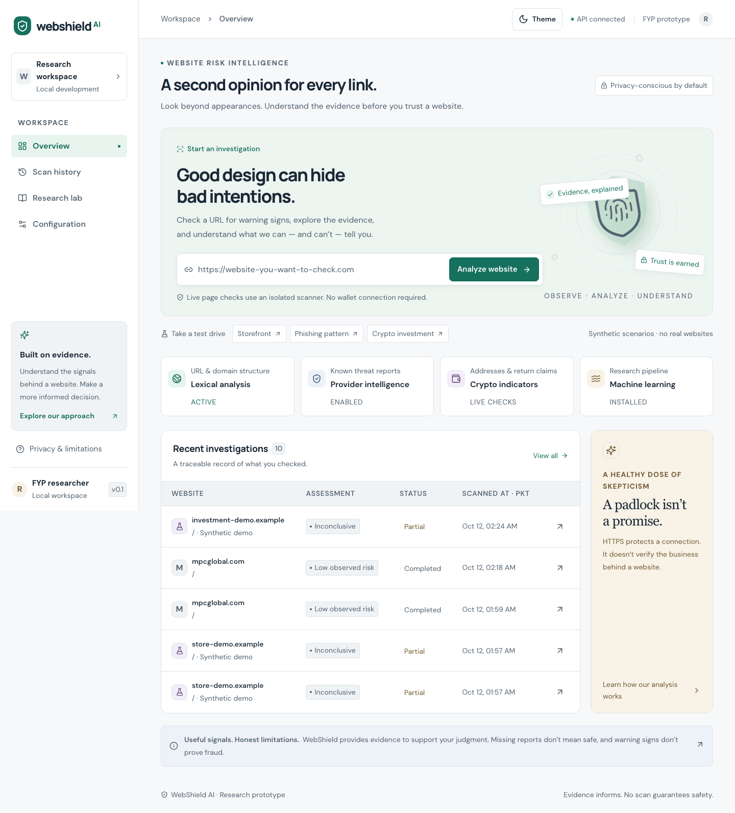
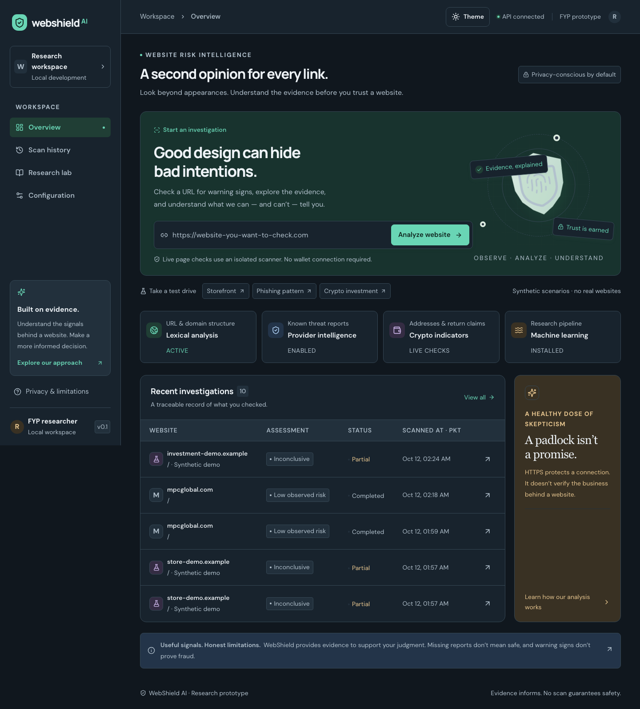
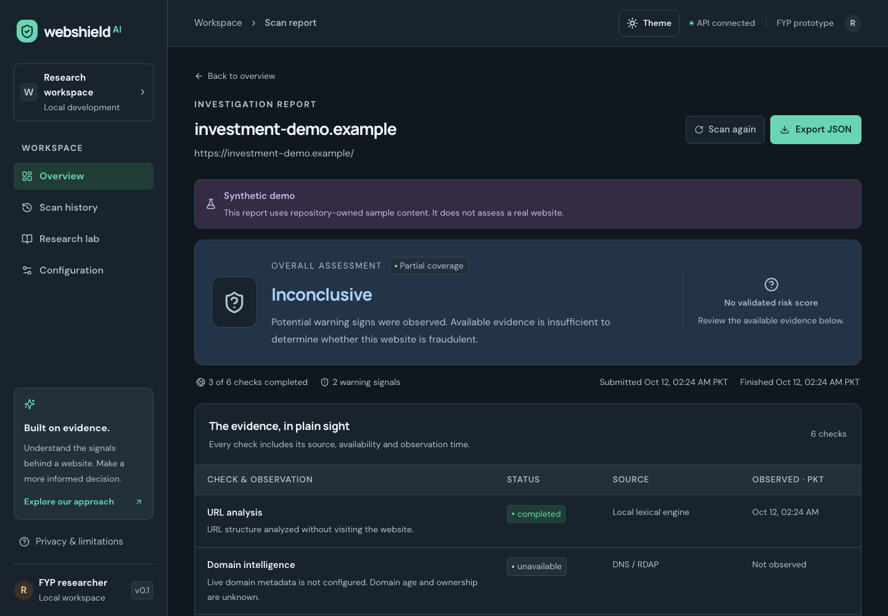
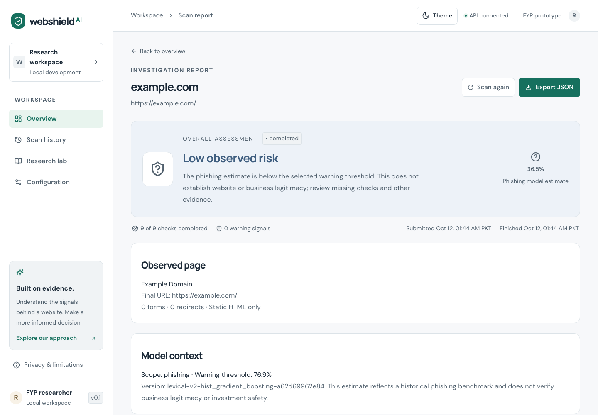
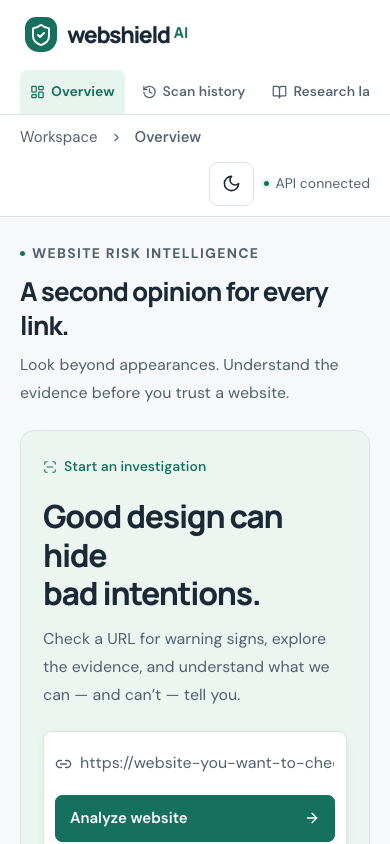

# WebShield AI User Manual

WebShield AI helps you review a public website URL using available evidence. Reports can include URL indicators, a phishing model estimate, current threat-provider observations and isolated static page/domain checks. A low estimate or missing provider match does not establish business legitimacy. This manual describes the controlled local application at `http://127.0.0.1:3000`.

**SAMPLE / DEMONSTRATION academic metadata:** Sample Student, FYP-0000, Sample University. These are dummy cover details, not actual authorship or institutional approval. Prepared 12 October 2026.

## 1 Start and navigate

Ask the local operator to start the verified services using the deployment checklist. Open the frontend address in a browser. The sidebar provides Overview, Scan history, Research and Configuration. On a small screen the layout adapts; tables have their own horizontal scrolling. Tab moves between controls, Enter activates links/submits the URL form, and Space activates the theme button.

Use the header sun/moon button to switch between light and dark mode. The first visit follows your device preference. A manual choice is remembered in this browser when storage is available; otherwise it works for the current session. Standard browser zoom and text-size preferences remain available.

## 2 Submit a website

1. On Overview, enter a complete public URL beginning with `https://` or `http://` in the Website URL field.
2. Remove private password-reset tokens, session keys or other secrets from query strings before submission. The full URL is saved and may be sent to enabled providers.
3. Select **Analyze website**. A saved report opens while the scan is queued or running.
4. Wait for a completed, partial or failed result. You can leave the page; accepted scans remain in history.

For a harmless live demonstration, use `https://example.com/`. Ordinary input validation rejects unsupported schemes, credentials in URLs, private/internal targets, disallowed ports and unsafe or ambiguous syntax. A readable rejection means no valid scan has been accepted. Public-looking hostnames that resolve to restricted addresses are blocked by the collector.

Avoid assuming the check is instant. Model startup and external observations take time. If the API reports queue submission failure with a saved scan ID, that failed record remains available for diagnosis.

## 3 Try synthetic scenarios

Overview's **Take a test drive** row offers Storefront, Phishing pattern and Crypto investment. Each uses repository-owned `.example` content and displays **Synthetic demo**. No real target site is assessed. Demonstrations exercise explanations and warning states; they are not research accuracy measurements.

The crypto scenario includes unrealistic return claims and candidate addresses. Address presence is not evidence of abuse, and WebShield never connects a wallet or performs transactions. A synthetic report may show unavailable ML rather than a numeric estimate; this is expected and must not be read as a real prediction.

## 4 Read the assessment

| Display                          | How to interpret it                                                                   |
| -------------------------------- | ------------------------------------------------------------------------------------- |
| Queued or running                | Processing has not finished; this is not an assessment                                |
| Completed                        | The configured workflow finished; coverage is still limited                           |
| Partial coverage                 | Useful evidence exists but one or more checks were unavailable                        |
| Failed or assessment unavailable | Processing failed; no legitimacy conclusion follows                                   |
| Low observed risk                | Available evidence did not cross the relevant warning conditions; uncertainty remains |
| Suspicious or high risk          | Model/rules warrant review; this does not independently prove fraud                   |
| Reported potential threat        | A current configured provider reported the exact URL; review source/freshness         |
| Inconclusive                     | Available evidence is insufficient for a stronger assessment                          |

When present, the percentage is a **phishing model estimate**, not a trust score or chance of investment loss. Model context identifies scope, version and selected warning threshold. The current model threshold is about 76.86%. Its held-out phishing recall is 58.41%, so many phishing examples were missed at that operating point. Do not ignore independent warnings because an estimate is below threshold.

Review **Threat provider freshness** for source, status, observation time and expiry. An expired historical positive loses current authority; select Scan again for a new check. Provider no-match, disabled, unavailable and expired states have different meanings. Configuration reports enablement, not guaranteed provider health.

Read **The evidence, in plain sight**, warning cards and the limitations panel together. Static HTML does not include all JavaScript behavior, hidden pages or authenticated content. DNS/RDAP and domain age do not identify a trustworthy operator. EVM address syntax does not identify the actual chain, ownership or transaction history.

## 5 History and resubmission

Select **Scan history** to open saved investigations. Open a row to return to its report. History is shared across this local deployment and uses paginated retrieval. The total is deployment-wide rather than a private personal count. UI times are shown in Pakistan time (PKT).

Select **Scan again** on a report to create a new saved submission with a new identifier. Previous observations remain historical evidence. Rechecking is useful when sources expired or evidence was temporarily unavailable. Repeating a scan does not make a warning or a low estimate more authoritative by itself.

## 6 Export evidence

Select **Export JSON** on a report. Save the downloaded attachment. It contains the scan ID, normalized URL, lifecycle, assessment, model context, evidence, per-provider timestamps/expiry, signals, features, crypto candidates and limitations.

The application export is JSON. The project report and this manual are also packaged as separate PDF/DOCX/HTML documents in `docs/submission/`. Saved JSON can contain sensitive URL parameters; review it before sharing. Export uses the same current freshness serialization as report retrieval, so expired provider authority can differ from its original observation while the stored observation remains intact.

## 7 Configuration and research

Configuration displays configured/enabled integrations and their privacy implications without exposing backend credentials. Users cannot enter API keys through this page. Only the operator changes root `.env` settings and restarts services.

Research describes model scope, feature groups and measured evaluations. The current runtime model is lexical phishing-only. Archived store/investment/crypto models are research-only; their content model had an 8.47% holdout FPR and is not installed as the phishing runtime. A new 200-URL prospective pilot shows no incremental group-holdout hybrid gain. A richer research URL candidate produces 12% false positives on its official reference cohort and remains unpromoted. These small source-confounded studies do not certify arbitrary sites. Synthetic scenarios and developer regression cases are kept separate from held-out accuracy.

## 8 Troubleshooting

| Symptom                               | Action and meaning                                                                                       |
| ------------------------------------- | -------------------------------------------------------------------------------------------------------- |
| Frontend cannot open                  | Operator should check frontend port 3000 and service status                                              |
| History or report unavailable         | Check API/health and database/queue connectivity; retry opening after recovery                           |
| URL validation error                  | Use a complete public HTTP(S) URL; remove embedded credentials and unsupported syntax                    |
| Scan remains queued/running           | Operator checks queue connectivity and persisted state; startup reconciliation recovers eligible records |
| Static content or domain unavailable  | Check isolated worker, token, flags and policy; an unavailable page is not a clean result                |
| ML unavailable                        | Check trusted installed bundle, runtime and model flag; a cold inference timeout can be resubmitted      |
| Provider unavailable                  | Operator checks enablement/key/network; no clean conclusion follows                                      |
| Provider expired                      | Select Scan again to obtain fresh evidence                                                               |
| Synthetic report has no numeric score | Expected: demo evidence is not a validated prediction of a real website                                  |
| Table extends beyond its card         | Scroll that table horizontally; the page itself should fit the viewport                                  |

Do not expose credentials when reporting a problem. Provide scan ID, approximate time, status and a redacted error description. The operator can use `GET /api/v1/health`, `GET /api/v1/model-info` and `GET /api/v1/providers` to diagnose local capability without printing keys.

## 9 Controlled demonstration sequence

1. Open Overview, switch light/dark themes and verify controls remain readable.
2. Run Storefront, Phishing pattern and Crypto investment synthetic scenarios; identify the demo notice and missing-score behavior.
3. Submit `https://example.com/`; inspect lifecycle, model scope, static evidence and provider status.
4. Open History and return to the saved benign report.
5. Download JSON, compare its scan ID and evidence with the report, then select Scan again and confirm a different record.
6. Review Research and Configuration to explain the measured model tradeoff, optional capabilities and privacy implications.

The example.com flow is a demonstration of application behavior, not evidence that WebShield can certify arbitrary sites. Use `docs/ACCEPTANCE_CHECKLIST.md` to record independent observations and human acceptance. No academic signature has been supplied.

## 10 Operator references

Setup, isolation, verification, preservation of history and restart instructions are in `docs/DEPLOYMENT_CHECKLIST.md`. API fields are documented in `docs/API.md`. Evaluation, source provenance, security boundaries and research limitations are in `docs/EVALUATION.md`, `docs/DATASET_CARD.md`, `docs/MODEL_CARD.md` and `docs/THREAT_MODEL.md`. The final report connects the proposal objectives to measured outcomes.

